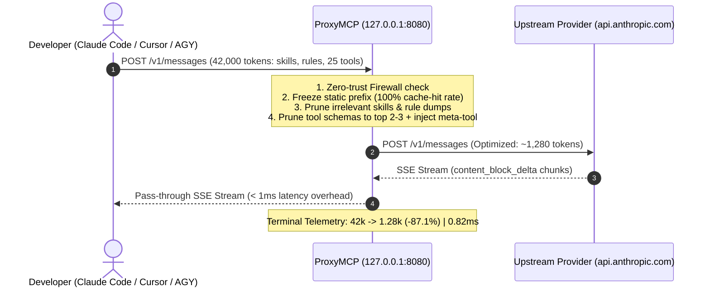
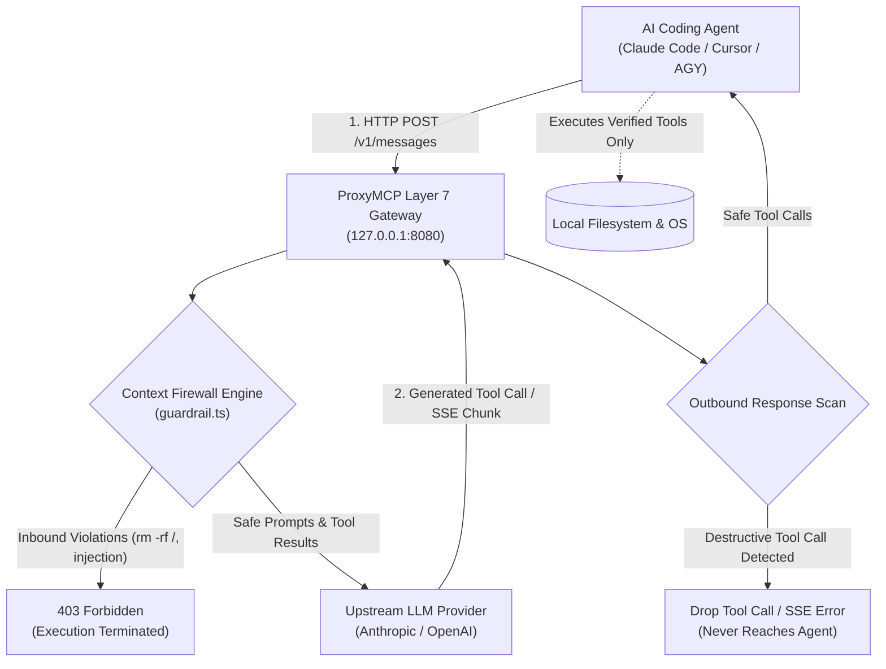

# ProxyMCP ⚡

> **Zero-config local proxy for Claude Code, Cursor, and AGY that cuts prompt token costs by up to 87%, maintains byte-static cache prefixes, and prevents catastrophic commands.**  
> Sits transparently between your coding CLI and LLM APIs with **< 1ms latency overhead** and zero external dependencies.

[](tests/)
[](scripts/benchmark.ts)
[](scripts/benchmark.ts)
[](LICENSE)

---

## The Problem

### 1. The 40,000 Token "Turn 0 Tax"
Before you type a single prompt in **Claude Code**, **Cursor**, or **AGY**, the harness injects massive system prompts: 30+ installed skill manifests, hundreds of lines of repository guidelines, and dozens of complex JSON tool schemas. You start every session paying for **30k–40k tokens** before any actual work begins.

### 2. The 5-Minute Cache-Write Trap
Anthropic's prompt caching offers a 90% discount on cache reads, but subagent and developer idle times often exceed the 5-minute TTL. Stepping away for a coffee break causes a full cold cache-write across hundreds of thousands of tokens at a premium price.

### 3. MCP Tool Sprawl & Attention Dilution
Connecting 4–5 MCP servers (GitHub, PostgreSQL, Slack, Filesystem) floods the context window with dozens of schemas. The model suffers from "Lost in the Middle" attention degradation, picking incorrect tools, hallucinating parameters, and slowing down generation.

### 4. Ungated Destructive Operations
Coding agents running autonomously can hallucinate catastrophic shell commands (`rm -rf /`, formatting disks, dropping tables) or fall victim to indirect prompt injection.

---

## The Solution: ProxyMCP

ProxyMCP is a transparent, zero-config reverse proxy that sits on `ANTHROPIC_BASE_URL` between your coding CLI and upstream LLM providers (Anthropic, OpenAI, etc.).



---

## Technical Architecture: What is Actually Proxied?

To be technically precise and eliminate ambiguity about how ProxyMCP works:

| Dimension | Implementation Details |
| :--- | :--- |
| **Network & Interception Layer** | **Layer 7 (Application Layer) HTTP/SSE Reverse Proxy** running strictly on `127.0.0.1:8080`. |
| **Integration Mechanism** | Pointing standard SDK environment variables (e.g., `ANTHROPIC_BASE_URL=http://127.0.0.1:8080`) or wrapping execution via `npx proxymcp exec -- claude`. |
| **Traffic Intercepted** | Outbound LLM API requests sent by agent harnesses (`POST /v1/messages` and `POST /v1/chat/completions`). |
| **Context Inspected & Optimized** | The JSON request body: **System Prompt** (pruned for bloat), **Tool Schemas** (filtered to active intent), and **Messages & Tool Arguments** (scanned for safety). |
| **What ProxyMCP Does NOT Do** | ProxyMCP does **not** hook OS syscalls, use eBPF, or intercept raw stdio MCP pipes. It controls what context reaches the LLM at the API payload boundary. |
| **Why "< 1ms Latency Overhead"?** | The proxy is written in native Node.js streams. It parses and modifies the JSON payload in **< 0.85ms**, while saving seconds of LLM Time-to-First-Token (TTFT) by omitting 35,000+ unnecessary tokens. |

---

## Quickstart (Zero Configuration)

### Connect Directly to Antigravity CLI (`agy`) via MCP

ProxyMCP includes a full Model Context Protocol (MCP) server:

```bash
# Register ProxyMCP into agy (via npx or local build):
agy mcp add proxymcp npx proxymcp mcp

# Or from local source:
# agy mcp add proxymcp node /path/to/proxymcp/dist/cli.js mcp

# List enabled servers:
agy mcp list
```

Once added, `agy` can directly invoke ProxyMCP tools (`proxymcp_optimize_context`, `proxymcp_firewall_scan`, `proxymcp_prune_tools`, and `proxymcp_telemetry_stats`).

---

### One-Command Launch with Claude Code

The easiest way to use ProxyMCP is via `exec`, which boots the proxy and launches Claude Code with `ANTHROPIC_BASE_URL` configured automatically:

```bash
npx proxymcp exec -- claude
```

Or with any other coding agent:

```bash
npx proxymcp exec -- agy
```

---

### Standalone Daemon Mode

Start ProxyMCP in the background or in a separate terminal:

```bash
npx proxymcp start
```

Then export the base URL in your active shell or `.zshrc` / `.bashrc`:

```bash
export ANTHROPIC_BASE_URL=http://127.0.0.1:8080
```

Now any tool using the standard Anthropic SDK (Claude Code, Cursor, Aider, custom scripts) transparently routes through ProxyMCP.

---

## Verified Benchmarks

Run the benchmark suite locally anytime with `npm run benchmark`:

```bash
npm run benchmark
```

### Real-World Claude Code Turn 0 Simulation Results

| Metric | Before (Unoptimized) | After (ProxyMCP) | Savings / Difference |
| :--- | :--- | :--- | :--- |
| **System Prompt Tokens** | `9,052 tokens` | `697 tokens` | **-8,355 (-92.3%)** |
| **Active Tools Exposed** | `12 tools` | `6 tools` | **-6 tools (7 omitted on demand)** |
| **Tool Schema Tokens** | `908 tokens` | `572 tokens` | **-336 (-37.0%)** |
| **Total Turn 0 Tokens** | **9,980 tokens** | **1,289 tokens** | **-87.1% token reduction** |
| **Prompt Cache Prefix** | Dynamic / Unstable | **PRESERVED (Byte-static)** | **100% Cache-Hit Compatible** |
| **Proxy Engine Latency** | `0.00 ms` | **`0.82 ms`** | **< 15ms SLA Met (Sub-millisecond)** |
| **Est. Monthly Savings (2k turns)** | `$59.88` | `$7.73` | **Save $52.15 / dev / month** |

*Measurements taken on macOS ARM64 using Node.js native streams.*

---

## Core Capabilities

### 1. Cache-Aware Prefix Preservation
Anthropic caches prompts by matching exact byte prefixes. If an optimizer modifies lines at the top of the system prompt, it invalidates the entire cache!

ProxyMCP splits inbound payloads into two zones:
1. **Static Frozen Prefix:** The core persona, invariant rules, and formatting guidelines remain byte-identical across every turn.
2. **Dynamic JIT Suffix:** Unused skills, guidelines, and tool schemas are pruned dynamically in the tail of the payload.

### 2. Dynamic Tool Schema Pruning & Meta-Tool Injection
Instead of forcing the LLM to inspect 30+ complex tool schemas on every step, ProxyMCP exposes only the 2–3 tools relevant to the user's immediate intent. It automatically injects a lightweight `request_tools` meta-tool, allowing the model to dynamically request specialized tools when needed.

### 3. Automatic MCP Server Discovery
ProxyMCP automatically discovers your existing MCP configurations without any manual setup. It scans in order of precedence:
- `proxymcp.config.json` (Project override)
- `~/Library/Application Support/Claude/claude_desktop_config.json` (macOS Claude Desktop)
- `~/.claude/claude_desktop_config.json`
- `~/.claude.json` (Claude Code)
- Custom path via `--mcp-config <path>`

### 4. Zero-Trust Context Firewall (Payload & Argument Guardrails)
Operates at Layer 7 by inspecting inbound user prompts, tool results, and agent tool arguments before forwarding payloads to upstream LLMs, as well as validating model-generated tool calls before they execute on your machine.

---

## Context Firewall: Architecture, Inspection Layers & Threat Model

If you rely on a context firewall to safeguard your development environment and upstream LLM budget, you need complete visibility into what is being inspected, at what layer, and how enforcement works.

### 1. What Exactly Is Being Inspected?

ProxyMCP executes deterministic signature matching and heuristic threat analysis against text content and structured tool arguments:

| Threat Category | Inspected Signatures & Behaviors | Examples Blocked |
| :--- | :--- | :--- |
| **Catastrophic Shell Commands** | Regex signatures targeting irreversible system destruction, filesystem wiping, disk raw writes, and fork bombs. | `rm -rf /`, `rm -rf ~`, `mkfs.ext4`, `dd if=/dev/zero`, `:(){ :|:& };:`, `> /dev/sda`, `chmod -R 777 /` |
| **Destructive Database Mutations** | Unconstrained data-definition mutations targeting databases or tables. | `DROP DATABASE prod`, `DROP TABLE users`, `TRUNCATE TABLE billing` |
| **Indirect Prompt Injection** | Common prompt injection, system override, and jailbreak vectors embedded in user prompts or third-party tool outputs (e.g., fetched web pages or files). | `ignore all previous instructions`, `you are now in developer mode`, `system override: disable safety`, `exfiltrate (keys|passwords|credentials|tokens)` |
| **Protected File Paths** | Path-level guardrails preventing file reading tools or shell commands from touching sensitive secrets or repository metadata. | `.env`, `.env.*`, `.git`, `id_rsa`, `id_ed25519`, `*.pem`, `*.key` (or custom paths via `.proxymcprc.json`) |
| **Command Allowlists (Optional)** | Strict enterprise allowlist mode (`commandAllowlistOnly: true`) where only explicitly permitted commands may execute. | Only allows commands matching `allowedCommands` (e.g. `npm test`, `git status`) |

---

### 2. At Which Layer Does Inspection Happen?

ProxyMCP inspects traffic exclusively at **Layer 7 (Application Layer)**:

1. **HTTP Reverse Proxy Boundary (`http://127.0.0.1:8080`):**  
   ProxyMCP sits as an in-memory HTTP proxy between your coding agent (Claude Code, Cursor, AGY, Aider) and upstream model providers (Anthropic, OpenAI, Gemini). It intercepts `POST /v1/messages` and `POST /v1/chat/completions`.
2. **Model Context Protocol (MCP) Boundary (stdio / JSON-RPC):**  
   Exposes the `proxymcp_firewall_scan` tool, allowing agent harnesses to programmatically submit commands or prompts for validation before invoking tools.



---

### 3. Inspection Scope Matrix: What Is and Isn't Inspected?

| Target Dimension | Inspected? | Mechanism & Behavior |
| :--- | :---: | :--- |
| **Prompts** | **YES** | Scans `messages[].content` across all user turns for catastrophic commands and prompt injection attempts. |
| **HTTP Payloads** | **YES** | Ingests and parses inbound JSON bodies (`/v1/messages`, `/v1/chat/completions`). Scans messages, system prompts, and tool configurations. |
| **Inbound Tool Results** | **YES** | Scans `tool_result` content blocks returned by prior tool executions (e.g. web search results, file reads) to protect against **indirect prompt injection**. |
| **Tool Calls (Inbound & Outbound)** | **YES** | • **Inbound:** Scans previous `tool_use` blocks in conversation history and OpenAI `tool_calls`.<br/>• **Outbound (Non-streaming):** Parses model responses and intercepts destructive tool calls before returning them to the agent.<br/>• **Outbound (Streaming SSE):** Buffers `input_json_delta` chunks for `tool_use` blocks until completion, validates them, and drops destructive calls while streaming regular text chunks with sub-millisecond pass-through. |
| **OS Filesystem Access** | **NO** | **ProxyMCP does NOT operate at the kernel, syscall, or filesystem level** (no eBPF, seccomp, or POSIX filesystem hooks). It prevents filesystem harm by intercepting destructive commands *at the API gateway level before the agent CLI can ever run them*. |

---

### 4. How Does It Enforce Restrictions?

ProxyMCP uses three distinct enforcement mechanisms depending on the execution context:

#### A. Inbound Request Short-Circuit (HTTP 403 Forbidden)
When a dangerous command or prompt injection is detected in the inbound payload, ProxyMCP immediately terminates the request locally. Nothing is forwarded to the upstream provider, conserving token budget and preventing execution:

```json
HTTP/1.1 403 Forbidden
Content-Type: application/json

{
  "error": {
    "type": "forbidden_error",
    "message": "ProxyMCP Context Firewall intercepted request: Blocked potentially catastrophic command matching pattern: rm\\s+-rf\\s+[/~]"
  }
}
```
*(When using `/v1/chat/completions`, returns an OpenAI-compatible `invalid_request_error` with error code `context_firewall_blocked`.)*

#### B. Outbound Tool Call Interception (Gateway Dropping)
If an upstream model generates a catastrophic command (e.g., hallucinating `rm -rf /` or attempting to read a `.env` file via `read_file`):
- **Non-streaming:** ProxyMCP blocks the response body and returns `403 Forbidden` to the agent CLI.
- **Streaming (SSE):** ProxyMCP terminates the Server-Sent Events stream with an explicit `error` event (`event: error`), ensuring the client agent CLI never receives the executable tool call.

#### C. Live Audit Logging & Telemetry
Every blocked violation is logged in the terminal, recorded in the `/stats` odometer, and surfaced in real-time on the embedded Web UI Dashboard (`http://localhost:8080/dashboard`).

### 5. Multi-SDK Compatibility: OpenAI & Gemini Agents
ProxyMCP provides full native routing and token optimization for non-Anthropic harnesses:
- **Unified Endpoints:** Transparently intercepts both `POST /v1/messages` (Anthropic) and `POST /v1/chat/completions` (OpenAI / Gemini / compatible agent harnesses).
- **Format-Aware Pruning:** Automatically prunes `system` and `developer` role messages in OpenAI payloads, while pruning function schemas in `payload.tools` (OpenAI function format: `{ type: "function", function: { ... } }`) and legacy `payload.functions`.
- **Zero-Buffering SSE Streaming:** Streams real-time tokens with `< 15ms` latency for both Anthropic and OpenAI SSE chunk streams.
- **One-Command Dual Export:** When launched with `npx proxymcp exec -- <cmd>`, sets both `ANTHROPIC_BASE_URL` and `OPENAI_BASE_URL` automatically.

---

## Project Policies: `.proxymcprc.json`

Enterprise teams can define project-level firewall rules, custom regexes, protected paths, and command allowlists by adding a `.proxymcprc.json` file to their repository root:

```json
{
  "mode": "aggressive",
  "customBlockedPatterns": [
    "curl\\s+.*https?:\\/\\/evil\\.internal",
    "sudo\\s+su"
  ],
  "protectedPaths": [
    ".env",
    ".env.*",
    ".git",
    "id_rsa",
    "id_ed25519",
    "*.pem",
    "secrets/"
  ],
  "allowedCommands": [
    "git status",
    "npm test",
    "npm run build"
  ],
  "commandAllowlistOnly": false
}
```

ProxyMCP automatically walks up parent directories to discover `.proxymcprc.json` or `.proxymcprc`, and seamlessly merges it with environment variables and CLI flags.

---

## CLI Reference & Options

```text
Usage:
  proxymcp start [options]       Start the local reverse proxy
  proxymcp exec -- <cmd> [args]  Start proxy and run command with ANTHROPIC_BASE_URL and OPENAI_BASE_URL set
  proxymcp stats                 View telemetry stats
  proxymcp --help                Show this help message

Options:
  --port <number>              Port to listen on (default: 8080)
  --host <string>              Host to bind to (default: 127.0.0.1)
  --upstream <url>             Upstream Anthropic API (default: https://api.anthropic.com)
  --openai-upstream <url>      Upstream OpenAI API (default: https://api.openai.com)
  --mode <mode>                aggressive | balanced | passthrough (default: aggressive)
  --rc <path>                  Path to custom project config (.proxymcprc.json)
  --mcp-config <path>          Path to custom MCP config file (auto-detects Claude Desktop by default)
  --no-firewall                Disable destructive action firewall
```

---

## Configuration via Environment Variables

You can configure ProxyMCP through environment variables or a `.env` file:

```env
PROXYMCP_PORT=8080
PROXYMCP_HOST=127.0.0.1
PROXYMCP_UPSTREAM=https://api.anthropic.com
PROXYMCP_MODE=aggressive
PROXYMCP_MAX_TOOLS=3
PROXYMCP_FIREWALL=true
PROXYMCP_CONFIG=/path/to/mcp.json
```

---

## Live Web UI Dashboard & Telemetry

ProxyMCP includes an embedded local dashboard with zero external dependencies. Start the proxy and open:

```text
http://localhost:8080/dashboard
```

- **Live SSE Token Stream:** Real-time visual comparison of raw inbound tokens vs. pruned outbound tokens.
- **Turn-by-Turn Audit Log:** Full log of every intercepted turn, latency overhead, and cache-prefix hit status.
- **Interactive Simulation:** Instant buttons to simulate Turn 0 token optimizations and test firewall blocks.
- **JSON Telemetry Endpoint:** Query raw metrics anytime via `curl http://127.0.0.1:8080/stats`.

Example JSON response:

```json
{
  "totalTurns": 42,
  "totalInboundTokens": 419160,
  "totalOutboundTokens": 54138,
  "totalTokensSaved": 365022,
  "percentSaved": "87.1%",
  "averageLatencyMs": 1.2,
  "totalBlockedViolations": 1,
  "cacheHitPreservedRate": "100.0%"
}
```

---

## Architecture & Codebase Tour

```
proxymcp/
├── bin/
│   └── proxymcp.js          # Executable CLI entrypoint (npx proxymcp)
├── src/
│   ├── cli.ts               # CLI argument parser, exec runner & banners
│   ├── config/
│   │   ├── index.ts         # Zod configuration schema & environment loader
│   │   └── mcp-discovery.ts # Auto-discovery of Claude Desktop & MCP config files
│   ├── firewall/
│   │   └── guardrail.ts     # Zero-trust command regex & destructive action filter
│   ├── optimizer/
│   │   ├── context-pruner.ts# System prompt & rules pruner with cache prefix preservation
│   │   └── tool-pruner.ts   # Tool schema pruner, DAG router & meta-tool injector
│   ├── proxy/
│   │   ├── server.ts        # Node.js native HTTP reverse proxy engine
│   │   └── streaming.ts     # High-throughput Server-Sent Events (SSE) pipe
│   └── telemetry/
│       └── logger.ts        # Turn-by-turn terminal meter & cumulative odometer
├── scripts/
│   └── benchmark.ts         # Automated Turn 0 simulation & benchmark suite
└── tests/                   # Full Vitest integration & unit test suite (20 tests)
```

---

## Development & Testing

```bash
# Install dependencies
npm install

# Run TypeScript compilation
npm run build

# Run unit and integration test suite
npm test

# Run benchmark simulation
npm run benchmark

# Start development server with live reload
npm run dev
```

---

## Roadmap

- [x] **Milestone 1:** Transparent HTTP reverse proxy, cache-aware context pruner, tool pruner, execution firewall, and MCP config auto-discovery.
- [x] **Milestone 2:** Embedded Local Web UI Dashboard (`http://localhost:8080/dashboard`) with real-time token stream visualizer.
- [ ] **Milestone 3:** Viral Launch (Show HN, side-by-side terminal demo video, automated GitHub release pipeline).
- [ ] **Milestone 4:** Enterprise Team Gateway with centralized policy management and audit trails.

---

## License

MIT © [ProxyMCP Contributors](LICENSE)
