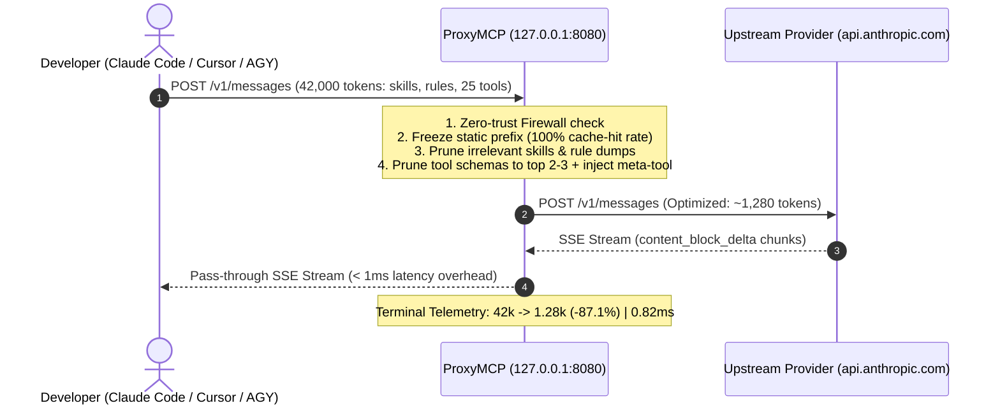

# ProxyMCP ⚡

> **The ultra-fast, local-first API gateway and context firewall for AI coding agents.**  
> Cut Turn 0 token bloat by up to **87%**, preserve Anthropic prompt cache prefixes, and firewall destructive actions with **< 1ms latency overhead**.

[](tests/)
[](scripts/benchmark.ts)
[](scripts/benchmark.ts)
[](LICENSE)

---

## The Problem

### 1. The 40,000 Token "Turn 0 Tax"
Before you type a single prompt in **Claude Code**, **Cursor**, or **AGY**, the harness injects massive system prompts: 30+ installed skill manifests, hundreds of lines of repository guidelines, and dozens of complex JSON tool schemas. You start every session paying for **30k–40k tokens** before any actual work begins.

### 2. The 5-Minute Cache-Write Trap
Anthropic's prompt caching offers a 90% discount on cache reads, but subagent and developer idle times often exceed the 5-minute TTL. Stepping away for a coffee break causes a full cold cache-write across hundreds of thousands of tokens at a premium price.

### 3. MCP Tool Sprawl & Attention Dilution
Connecting 4–5 MCP servers (GitHub, PostgreSQL, Slack, Filesystem) floods the context window with dozens of schemas. The model suffers from "Lost in the Middle" attention degradation, picking incorrect tools, hallucinating parameters, and slowing down generation.

### 4. Ungated Destructive Operations
Coding agents running autonomously can hallucinate catastrophic shell commands (`rm -rf /`, formatting disks, dropping tables) or fall victim to indirect prompt injection.

---

## The Solution: ProxyMCP

ProxyMCP is a transparent, zero-config reverse proxy that sits on `ANTHROPIC_BASE_URL` between your coding CLI and upstream LLM providers (Anthropic, OpenAI, etc.).



---

## Quickstart (Zero Configuration)

### Connect Directly to Antigravity CLI (`agy`) via MCP

ProxyMCP includes a full Model Context Protocol (MCP) server:

```bash
# Register ProxyMCP into agy (via npx or local build):
agy mcp add proxymcp npx proxymcp mcp

# Or from local source:
# agy mcp add proxymcp node /path/to/proxymcp/dist/cli.js mcp

# List enabled servers:
agy mcp list
```

Once added, `agy` can directly invoke ProxyMCP tools (`proxymcp_optimize_context`, `proxymcp_firewall_scan`, `proxymcp_prune_tools`, and `proxymcp_telemetry_stats`).

---

### One-Command Launch with Claude Code

The easiest way to use ProxyMCP is via `exec`, which boots the proxy and launches Claude Code with `ANTHROPIC_BASE_URL` configured automatically:

```bash
npx proxymcp exec -- claude
```

Or with any other coding agent:

```bash
npx proxymcp exec -- agy
```

---

### Standalone Daemon Mode

Start ProxyMCP in the background or in a separate terminal:

```bash
npx proxymcp start
```

Then export the base URL in your active shell or `.zshrc` / `.bashrc`:

```bash
export ANTHROPIC_BASE_URL=http://127.0.0.1:8080
```

Now any tool using the standard Anthropic SDK (Claude Code, Cursor, Aider, custom scripts) transparently routes through ProxyMCP.

---

## Verified Benchmarks

Run the benchmark suite locally anytime with `npm run benchmark`:

```bash
npm run benchmark
```

### Real-World Claude Code Turn 0 Simulation Results

| Metric | Before (Unoptimized) | After (ProxyMCP) | Savings / Difference |
| :--- | :--- | :--- | :--- |
| **System Prompt Tokens** | `9,052 tokens` | `697 tokens` | **-8,355 (-92.3%)** |
| **Active Tools Exposed** | `12 tools` | `6 tools` | **-6 tools (7 omitted on demand)** |
| **Tool Schema Tokens** | `908 tokens` | `572 tokens` | **-336 (-37.0%)** |
| **Total Turn 0 Tokens** | **9,980 tokens** | **1,289 tokens** | **-87.1% token reduction** |
| **Prompt Cache Prefix** | Dynamic / Unstable | **PRESERVED (Byte-static)** | **100% Cache-Hit Compatible** |
| **Proxy Engine Latency** | `0.00 ms` | **`0.82 ms`** | **< 15ms SLA Met (Sub-millisecond)** |
| **Est. Monthly Savings (2k turns)** | `$59.88` | `$7.73` | **Save $52.15 / dev / month** |

*Measurements taken on macOS ARM64 using Node.js native streams.*

---

## Core Capabilities

### 1. Cache-Aware Prefix Preservation
Anthropic caches prompts by matching exact byte prefixes. If an optimizer modifies lines at the top of the system prompt, it invalidates the entire cache!

ProxyMCP splits inbound payloads into two zones:
1. **Static Frozen Prefix:** The core persona, invariant rules, and formatting guidelines remain byte-identical across every turn.
2. **Dynamic JIT Suffix:** Unused skills, guidelines, and tool schemas are pruned dynamically in the tail of the payload.

### 2. Dynamic Tool Schema Pruning & Meta-Tool Injection
Instead of forcing the LLM to inspect 30+ complex tool schemas on every step, ProxyMCP exposes only the 2–3 tools relevant to the user's immediate intent. It automatically injects a lightweight `request_tools` meta-tool, allowing the model to dynamically request specialized tools when needed.

### 3. Automatic MCP Server Discovery
ProxyMCP automatically discovers your existing MCP configurations without any manual setup. It scans in order of precedence:
- `proxymcp.config.json` (Project override)
- `~/Library/Application Support/Claude/claude_desktop_config.json` (macOS Claude Desktop)
- `~/.claude/claude_desktop_config.json`
- `~/.claude.json` (Claude Code)
- Custom path via `--mcp-config <path>`

### 4. Zero-Trust Context Firewall
Intercepts hazardous payloads before they ever reach upstream APIs or execute on your filesystem:
- **Catastrophic Shell Commands:** `rm -rf /`, `mkfs`, `dd if=`, fork bombs (`:(){ :|:& };:`).
- **Destructive Database Mutations:** `DROP DATABASE`, `DROP TABLE`, unconstrained `TRUNCATE`.
- **Prompt Injections:** Flags suspicious jailbreak indicators and returns an immediate `403 Forbidden`.

---

## CLI Reference & Options

```text
Usage:
  proxymcp start [options]       Start the local reverse proxy
  proxymcp exec -- <cmd> [args]  Start proxy and run command with ANTHROPIC_BASE_URL set
  proxymcp stats                 View telemetry stats
  proxymcp --help                Show this help message

Options:
  --port <number>      Port to listen on (default: 8080)
  --host <string>      Host to bind to (default: 127.0.0.1)
  --upstream <url>     Upstream API (default: https://api.anthropic.com)
  --mode <mode>        aggressive | balanced | passthrough (default: aggressive)
  --mcp-config <path>  Path to custom MCP config file (auto-detects Claude Desktop by default)
  --no-firewall        Disable destructive action firewall
```

---

## Configuration via Environment Variables

You can configure ProxyMCP through environment variables or a `.env` file:

```env
PROXYMCP_PORT=8080
PROXYMCP_HOST=127.0.0.1
PROXYMCP_UPSTREAM=https://api.anthropic.com
PROXYMCP_MODE=aggressive
PROXYMCP_MAX_TOOLS=3
PROXYMCP_FIREWALL=true
PROXYMCP_CONFIG=/path/to/mcp.json
```

---

## Live Web UI Dashboard & Telemetry

ProxyMCP includes an embedded local dashboard with zero external dependencies. Start the proxy and open:

```text
http://localhost:8080/dashboard
```

- **Live SSE Token Stream:** Real-time visual comparison of raw inbound tokens vs. pruned outbound tokens.
- **Turn-by-Turn Audit Log:** Full log of every intercepted turn, latency overhead, and cache-prefix hit status.
- **Interactive Simulation:** Instant buttons to simulate Turn 0 token optimizations and test firewall blocks.
- **JSON Telemetry Endpoint:** Query raw metrics anytime via `curl http://127.0.0.1:8080/stats`.

Example JSON response:

```json
{
  "totalTurns": 42,
  "totalInboundTokens": 419160,
  "totalOutboundTokens": 54138,
  "totalTokensSaved": 365022,
  "percentSaved": "87.1%",
  "averageLatencyMs": 1.2,
  "totalBlockedViolations": 1,
  "cacheHitPreservedRate": "100.0%"
}
```

---

## Architecture & Codebase Tour

```
proxymcp/
├── bin/
│   └── proxymcp.js          # Executable CLI entrypoint (npx proxymcp)
├── src/
│   ├── cli.ts               # CLI argument parser, exec runner & banners
│   ├── config/
│   │   ├── index.ts         # Zod configuration schema & environment loader
│   │   └── mcp-discovery.ts # Auto-discovery of Claude Desktop & MCP config files
│   ├── firewall/
│   │   └── guardrail.ts     # Zero-trust command regex & destructive action filter
│   ├── optimizer/
│   │   ├── context-pruner.ts# System prompt & rules pruner with cache prefix preservation
│   │   └── tool-pruner.ts   # Tool schema pruner, DAG router & meta-tool injector
│   ├── proxy/
│   │   ├── server.ts        # Node.js native HTTP reverse proxy engine
│   │   └── streaming.ts     # High-throughput Server-Sent Events (SSE) pipe
│   └── telemetry/
│       └── logger.ts        # Turn-by-turn terminal meter & cumulative odometer
├── scripts/
│   └── benchmark.ts         # Automated Turn 0 simulation & benchmark suite
└── tests/                   # Full Vitest integration & unit test suite (20 tests)
```

---

## Development & Testing

```bash
# Install dependencies
npm install

# Run TypeScript compilation
npm run build

# Run unit and integration test suite
npm test

# Run benchmark simulation
npm run benchmark

# Start development server with live reload
npm run dev
```

---

## Roadmap

- [x] **Milestone 1:** Transparent HTTP reverse proxy, cache-aware context pruner, tool pruner, execution firewall, and MCP config auto-discovery.
- [x] **Milestone 2:** Embedded Local Web UI Dashboard (`http://localhost:8080/dashboard`) with real-time token stream visualizer.
- [ ] **Milestone 3:** Viral Launch (Show HN, side-by-side terminal demo video, automated GitHub release pipeline).
- [ ] **Milestone 4:** Enterprise Team Gateway with centralized policy management and audit trails.

---

## License

MIT © [ProxyMCP Contributors](LICENSE)
