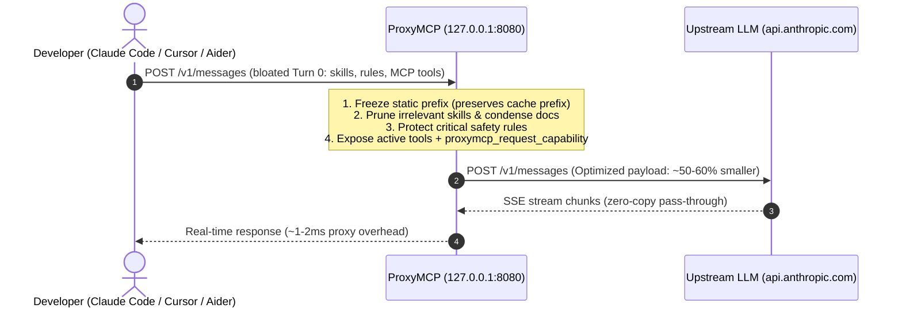

# ProxyMCP ⚡

> **Local HTTP reverse proxy for Claude Code & AI coding agents that cuts Turn 0 prompt and tool bloat while preserving prompt cache prefixes.**  
> Sits transparently between your coding CLI and LLM APIs with ~1–2ms latency overhead and zero external dependencies.

[](tests/)
[](scripts/test-agent-session.ts)
[](src/optimizer/context-pruner.ts)
[](LICENSE)

---

## The Problem: Turn 0 Prompt Bloat

Modern AI coding agents (such as Claude Code and Cursor) inject extensive context into the system prompt before you type your first message:

- **Installed skill manifests**: System instructions and usage guides for dozens of skills (~10,000–20,000 tokens)
- **Repository guidelines and enterprise rules**: Coding conventions, architecture notes, and style guidelines (~5,000–10,000 tokens)
- **MCP tool schemas**: Full JSON parameter schemas for every registered Model Context Protocol tool (~5,000–15,000 tokens)

### Practical Implications:
1. **Cold Cache-Write Cost**: When a session is idle past Anthropic's 5-minute cache TTL, the next prompt incurs a full-price cache write across 20k–40k tokens.
2. **Context Dilution**: Exposing 30+ inactive tool schemas increases the likelihood of tool selection errors and argument hallucination.
3. **Cache-Breakage Risk**: Modifying text at the beginning of the prompt breaks Anthropic's exact byte-prefix matching, invalidating prompt cache discounts.

---

## How ProxyMCP Works

ProxyMCP runs locally as a lightweight Layer 7 reverse proxy on `127.0.0.1:8080`. When your coding agent sends requests to Anthropic (`/v1/messages`) or OpenAI-compatible endpoints (`/v1/chat/completions`), ProxyMCP optimizes the payload in flight:

1. **Freezes Byte-Static Cache Prefixes**: Keeps the first 1,500 characters of the system prompt (core persona, formatting instructions) 100% byte-identical to maintain Anthropic prompt cache compatibility.
2. **Prunes Irrelevant Skills & Condenses Guidelines**: Filters out unneeded skill descriptions based on the current prompt. Scans the full content of repository rules to retain relevant guidelines.
3. **Protects Safety Invariants**: Strictly prevents pruning of critical rules containing security, migration, compliance, or strict invariant directives (e.g., rules mentioning "never", "always", "database migration", "security").
4. **Dynamic Tool Rehydration**: Exposes only core tools plus tools relevant to the current user turn (capped by `maxActiveTools`), alongside a lightweight meta-tool `proxymcp_request_capability`. When the model calls this meta-tool to request an omitted tool, the proxy intercepts the call, restores the tool's full schema from memory, generates the synthetic tool result, and auto-completes the turn upstream.
5. **Zero-Copy Streaming**: Forwards Server-Sent Events (SSE) directly to the client without buffering tokens, adding only ~1–2ms of proxy processing time.



---

## Quickstart

### 1. One-Command Launch with Claude Code

The `exec` command starts the local proxy in the background and launches Claude Code with `ANTHROPIC_BASE_URL` pre-configured:

```bash
npx proxymcp exec -- claude
```

Or with Aider:

```bash
npx proxymcp exec -- aider --model anthropic/claude-3-5-sonnet-20241022
```

### 2. Standalone Daemon Mode

Start ProxyMCP in its own terminal:

```bash
npx proxymcp start
```

Then point your agent to the local proxy:

```bash
export ANTHROPIC_BASE_URL=http://127.0.0.1:8080
export OPENAI_BASE_URL=http://127.0.0.1:8080/v1
```

Any tool or SDK script using standard Anthropic or OpenAI environment variables will route through ProxyMCP automatically.

---

## Agent Compatibility Matrix

| Client / Harness | Protocol / Transport | Compatibility | Connection Method |
| :--- | :--- | :---: | :--- |
| **Claude Code** | HTTP / REST (`/v1/messages`) | **Full** | `npx proxymcp exec -- claude` or set `ANTHROPIC_BASE_URL` |
| **Cursor Composer** | HTTP / REST (`/v1/chat/completions`) | **Full** | Set custom Base URL to `http://127.0.0.1:8080/v1` in Cursor settings |
| **Aider** | HTTP / REST | **Full** | `aider --openai-api-base http://127.0.0.1:8080/v1` |
| **Custom Agent Scripts** (Node/Python) | HTTP / REST (`@anthropic-ai/sdk`, `openai`) | **Full** | Set `baseURL: "http://127.0.0.1:8080"` in SDK client options |
| **Antigravity CLI (`agy`)** | Google Cloud gRPC (`codeassist`) | **Not Supported** | Uses internal gRPC, not HTTP. Does not route through HTTP proxies. |

---

## Real-World Verification

### 1. Verify with Claude Code `/context`

You can verify real token reduction directly in Claude Code:

1. **Baseline**: Run standard Claude Code (`claude`) and type `/context`. Check the initial Turn 0 token footprint (often 20,000–40,000 tokens with installed skills and MCP tools).
2. **With ProxyMCP**: Run `npx proxymcp exec -- claude` and type `/context`. Compare the initial tokens consumed.

You can also run our automated verification helper:

```bash
npm run live-check
```

### 2. Standalone Multi-Turn Session Simulation

To test the proxy, tool pruning, dynamic rehydration, and session memory without needing Claude Code or active API keys, run:

```bash
npm run test:session
```

This simulator executes 4 realistic multi-turn interactions against a mock upstream:
- **Turn 1 (Prompt Bloat Optimization)**: Prunes 22 skills and 9 tool schemas down by ~62%, while strictly retaining database and security safety invariants.
- **Turn 2 (Dynamic Capability Rehydration)**: Simulates the model requesting an omitted Stripe payment capability. ProxyMCP catches `proxymcp_request_capability`, rehydrates the schema, and auto-completes the turn.
- **Turn 3 & 4 (Session Memory & Prefix Stability)**: Confirms rehydrated tools stay active for subsequent turns while maintaining byte-static prompt cache prefix compatibility.

Measured multi-turn simulation output:
- **Total Inbound Tokens**: 4,034 tokens
- **Total Outbound Tokens**: 1,933 tokens
- **Tokens Saved**: 2,101 tokens (52.1% reduction)
- **Average Proxy Latency**: 1.5 ms

---

## Live Web Dashboard

ProxyMCP includes a local telemetry dashboard accessible while the proxy is running:

```
http://127.0.0.1:8080/dashboard
```

The dashboard displays:
- **Tokens Saved & % Reduction** across all session turns
- **Estimated Cost Savings** (calculated on Claude 3.5 Sonnet pricing)
- **Proxy Latency Overhead** in milliseconds
- **Prompt Cache Prefix Status** (byte-static prefix check)
- **Turn-by-Turn History**: Inbound vs. outbound token counts and active tool counts

---

## Synthetic Benchmark Simulation

To inspect worst-case Turn 0 behavior under a heavy catalog (35 installed skills, 12 enterprise rules, 12 MCP tools):

```bash
npm run benchmark
```

### Simulation Results:

| Metric | Unoptimized | With ProxyMCP | Difference |
| :--- | :--- | :--- | :--- |
| **System Prompt Tokens** | `9,052 tokens` | `3,338 tokens` | **-5,714 (-63.1%)** |
| **Active Tools Exposed** | `12 tools` | `4 tools` | **-8 tools (available on demand)** |
| **Tool Schema Tokens** | `908 tokens` | `411 tokens` | **-497 (-54.7%)** |
| **Total Turn 0 Tokens** | **9,980 tokens** | **3,769 tokens** | **-62.2% token reduction** |
| **Prompt Cache Prefix** | Dynamic | **Preserved (Byte-static)** | **Cache-Hit Compatible** |
| **Pruning Engine Latency** | `0.00 ms` | **`0.86 ms`** | **< 1ms in-memory execution** |

*Note: Real-world savings depend on the number of installed skills and connected MCP tools in your environment (typically 30%–70% on Turn 0).*

---

## Configuration (`.proxymcprc.json`)

You can customize proxy behavior by placing a `.proxymcprc.json` in your repository root or home directory:

```json
{
  "mode": "aggressive",
  "staticPrefixLength": 1500,
  "maxActiveTools": 4,
  "coreTools": ["bash", "read_file", "edit_file"]
}
```

- **`mode`**: `aggressive` (prunes skills and tool schemas), `balanced` (prunes skills only), or `passthrough` (no pruning).
- **`staticPrefixLength`**: Number of characters at the start of the system prompt frozen byte-identically for prompt cache preservation (default: `1500`).
- **`maxActiveTools`**: Maximum number of tool schemas to expose simultaneously (default: `4`).
- **`coreTools`**: Tools that are always retained regardless of query terms.

---

## License

MIT © Edoardo Sproccati
